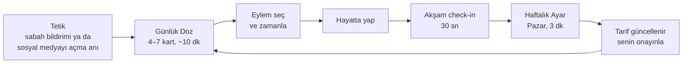

# 2. Ürün Tasarımı

## Temel kavramlar

| Kavram | Açıklama | Örnek |
|---|---|---|
| **Kimlik** | Olmak istediğin kişiyi tarif eden tek cümle. Uygulamanın pusulası. | "Her gün okuyan, bedenine iyi bakan ve öğrendiğini paylaşan biriyim." |
| **Sütun** | Kimliğini oluşturan 1–3 gelişim alanı. Her birinin bir *nedeni*, *seviyesi* ve *zaman bütçesi* var. | Okuma (başlangıç, "daha derin düşünmek istiyorum", haftada 3 saat) |
| **Yol** | Her sütun için 4 haftalık, sıralı bir müfredat. Görünür; atlanabilir, değiştirilebilir. | "Okuma: 1. hafta zaman bul, 2. hafta dikkatini koru..." |
| **Tarif** | Algoritmanın kendisi: Hangi sütuna ne kadar ağırlık, hangi içerik türünden ne kadar, ne kadar süre, hangi ton. Kullanıcı düzenler. | Okuma %50 · Spor %30 · Yazma %20 · Öğren/Uygula/İlham/Yansıt = 30/40/15/15 |
| **Günlük Doz** | Her gün hazırlanan, 4–7 karttan oluşan, bitirilebilir set. | 10 dakika, 6 kart |
| **Kart** | Dozun yapı taşı: *Öğren, Uygula, İlham, Yansıt, Kaynak*. | Aşağıda |
| **Eylem** | Bir "Uygula" kartından doğan, zamana bağlanmış somut adım. | "Bu akşam 21:30'da 10 sayfa oku" |
| **Raf** | Sınırlı "sonra yaparım" alanı: En fazla 7 öğe, her biri tarihli, 7 günde süresi dolar. | — |
| **Haftalık Ayar** | Pazar günü 3 dakikalık değerlendirme. Sistem tarifte değişiklik önerir, kullanıcı onaylar. | "Spor kartlarını hep atladın. Ağırlığı azaltalım mı, yoksa daha kısa egzersizlere mi geçelim?" |

## Çekirdek döngü



Döngünün en önemli adımı **Hayatta yap**. Bu adım uygulamanın dışında geçer, ve ürünün başarısını burada ölçeriz.

## Tanıtım: Neden bu uygulama, ne bekleyebilirsin?

Kurulumdan önce 5 sayfalık, her sayfadan atlanabilen bir tanıtım. Amaç kullanıcının iki soruya cevap bulması: **"Bunu neden kullanayım?"** ve **"Kullanınca ne olacak?"** Metin 250 kelimenin altında tutulur (yaklaşık 1–1,5 dakika; testle korunuyor). Sonradan Tarif ekranındaki "Uygulama nasıl çalışır?" bağlantısıyla tekrar açılabilir.

| # | Soru | Başlık | Ana mesaj | Görsel |
|---|---|---|---|---|
| 1 | Neden buradasın? | Bugün kaç kez "bir tane daha" dedin? | Kaydetme yanılsaması, FOMO, kıyas. **Sorun sende değil:** Akış hedeflerin için değil, dikkatin için tasarlandı. | Solarak devam eden bir akış: "Kaydedildi", "Gündem", "Kıyas" etiketli gönderiler |
| 2 | Burada ne farklı? | Algoritma seni değil, sen algoritmayı yönetirsin. | Kim olmak istediğini sen söylersin; her kartta onu neden gördüğün yazar. | Karşılaştırma: Sonsuz akış → Her gün biten doz, Kaydet → Bugün yap ya da tarih ver, Gizli algoritma → Senin tarifin, Beğeni ve kıyas → Dünkü sen |
| 3 | Nasıl çalışır? | Bir gün böyle geçer | Uygulamada günde 5–15 dakika, gerisi hayatta. | Zaman çizelgesi: Sabah doz → hemen eylem → gün içinde hayatta → akşam 30 sn check-in |
| 4 | Ne bekleyebilirsin? | Büyük bir dönüşüm değil, her gün küçük bir adım | İlk hafta küçük adımlar; 2–3. hafta ritim oturur; 1 ay sonra sosyal medya süresi başlangıçla karşılaştırılır. Ölçülen şey uygulamada geçen süre değil, hayatta yapılanlar. **Gün atlamak normal; ceza yok.** | Haftalık zaman çizelgesi |
| 5 | Sözümüz | Seni ekranda tutmaya çalışmayacağız | Sonsuz akış, beğeni, korkutan bildirim, reklam yok. Kullanıcıdan tek beklenti: günde birkaç dakika ve küçük bir adım. | Söz listesi |

Kurallar:
- **Vaat değil, beklenti.** "Hayatın değişecek" gibi garanti verilmez. Ne yapacağımızı ve neyi ölçeceğimizi söyleriz.
- **Suçlama yok.** İlk sayfa kullanıcıyı değil, akışın tasarımını sorumlu tutar.
- **Atlanabilir.** Her sayfada "Atla" var; zorunlu tanıtım, sabırsız kullanıcıyı kaybettirir.

### İlk doz ipuçları

Tanıtım genel resmi anlatır; kart türleri ise ilk kez görüldüğü anda anlatılır. İlk dozda her kartın üstünde kısa bir "İpucu" kutusu çıkar (öğren, uygula, ilham, yansıt). İlk doz bitince kullanıcıya bir sonraki adım söylenir: "Şimdi uygulamayı kapat; akşam eylemini işaretle." İkinci günden itibaren ipuçları gösterilmez.

## Onboarding (en fazla 3 dakika)

0. **Tanıtım** (yukarıda; atlanabilir).
1. **"5 yıl sonraki sen nasıl biri?"** Hazır kimlik şablonlarından birini seç (Okuyan, Hareket eden, Üreten, Yazılım öğrenen, Odaklanan) ya da kendin yaz. Sistem bunu tek cümlelik bir kimlik ifadesine çevirir, sen düzeltirsin.
2. **Sütunlarını seç.** En fazla 3 (ücretsiz planda 1). Mesaj: "Ne kadar az, o kadar iyi."
3. **Her sütun için neden ve seviye.** "Bunu neden istiyorsun?" cevabı saklanır ve zor günlerde kullanıcıya kendi cümlesiyle hatırlatılır.
4. **Zaman bütçesi.** "Günde bana kaç dakika ayırırsın?" (5 / 10 / 15). Bir de başlangıç ölçümü: "Şu an günde kaç saat sosyal medyadasın?" (İsteğe bağlı olarak ekran süresi ekran görüntüsü.)
5. **Tarif önizlemesi.** "Algoritman bu. İstediğin an değiştirebilirsin." Kullanıcı kontrolün kendisinde olduğunu ilk dakikadan görür.
6. **İlk doz hemen gelir.** Bekletme yok. İlk "aha" anı ilk 3 dakikada yaşanmalı.

## Günlük Doz anatomisi

Örnek: Deniz. Sütunlar: Okuma (%60), Hareket (%40). Bütçe: 10 dakika.

| # | Tür | Süre | İçerik (örnek kart) |
|---|---|---|---|
| 1 | **Öğren** | 2 dk | *Okuduğunu neden unutuyorsun?* Okuduktan sonra kitabı kapatıp hatırlamaya çalışmak, tekrar okumaktan daha kalıcıdır (aktif hatırlama). |
| 2 | **Uygula** | 1 dk + eylem | *3 cümle kuralı:* Bu akşam okuduğun bölümü kapat, 3 cümleyle yaz. → **[Bu akşam 21:30] [Başka saat] [Bugün değil]** |
| 3 | **Öğren** | 2 dk | *Hareketin en küçük birimi:* 2 dakika kuralı. Ayakkabını giy, kapıdan çık. Başlamak, devam etmekten zordur. |
| 4 | **Uygula** | eylem | *Yarın sabah 10 squat.* Alarmın hemen ardından. → **[Ekle]** |
| 5 | **İlham** | 1 dk | Bir sürecin hikâyesi: Sonuç değil, ilk 3 ay. Neyin zor olduğu, nasıl küçültüldüğü. |
| 6 | **Yansıt** | 30 sn | *Dün telefonu bırakmakta en çok nerede zorlandın?* (tek satır ya da emoji) |
| — | **Bitiş** | — | **"Bugünlük bu kadar. Gerisi hayatta."** Bugünkü eylemlerin: 2. Yarınki doz: 07:30. **[Kapat]** |

Kurallar:
- Her "Öğren" kartına bağlı bir "Uygula" kartı vardır.
- Bir dozda en fazla 1 "İlham" kartı olur. İlham kartları **sonucu değil süreci** anlatır.
- Bitiş ekranında "daha fazla göster" butonu **yoktur**. Kullanıcı isterse tek bir "Derinleş" kaynağı açabilir, süre etiketiyle birlikte ("Bu video 18 dk"). Bu bilinçli bir seçimdir, sonsuz akış değil.

### Kart tipleri

| Tip | Amaç | Format | Kural |
|---|---|---|---|
| **Öğren** | Yoldaki bir sonraki kavram | 60–150 kelime, tek fikir | Her zaman bir eylemle eşleşir |
| **Uygula** | Bilgiyi davranışa çevirmek | Somut, en fazla 15 dk, zamanlanabilir | Seçenekler "bugün / saat seç / bugün değil"; "kaydet" yok. Her eylemin 2 dakikalık "kötü gün versiyonu" var |
| **İlham** | Motivasyon vermek, yetersizlik hissettirmeden | Kısa hikâye, alıntı, araştırma bulgusu | Süreç > sonuç. "X yaşında milyoner oldu" türü içerik yok |
| **Yansıt** | Farkındalık ve kişiselleştirme verisi | Tek soru, tek satır cevap | Cevaplar sonraki dozları şekillendirir |
| **Kaynak** | Dışarıdaki derin içerik (kitap bölümü, video, makale) | Link + neden + "ne alacaksın" + süre | Günde en fazla 1, isteğe bağlı |

## "Algoritmayı sen yönet": somut karşılığı

Bu sloganın ürün içinde somut karşılığı olmalı, yoksa pazarlama cümlesi olarak kalır. Beş mekanizma:

### 1. Tarif ekranı (kontrol paneli)
Algoritmanın tamamı tek ekranda:
- **Sütun ağırlıkları:** kaydırıcılarla (%60 Okuma / %40 Hareket)
- **İçerik karışımı:** Öğren / Uygula / İlham / Yansıt oranları
- **Günlük süre:** 5 / 10 / 15 dk
- **Derinlik:** Temel / Orta / İleri
- **Ton:** Nazik arkadaş / Dürüst koç / Sert antrenör
- **Format tercihi:** Yazı / ses / video kaynak
- **Asla gösterme:** konu veya kelime listesi (ör. "diyet", "para kazanma")

### 2. "Bunu neden görüyorum?"
Her kartın köşesinde bulunur. Örnek açıklama:
> Okuma sütunun (%60) · Yol: 2. hafta, 3. gün, "Dikkatini koru" · Dün "çok kolay" dedin, bir seviye daha derin bir kart seçildi.

### 3. Sadece açık geri bildirim
Her kartta hafif bir geri bildirim satırı: **İşe yaradı · Çok kolay · Çok zor · Zaten biliyorum · Böylesini az göster.** Sıralama bu sinyallere ve eylem tamamlamaya dayanır. Bir kartta kaç saniye kaldığın sıralamada kullanılmaz.

### 4. Öner–onayla modeli
Sistem tarifi kendi başına değiştirmez. Haftalık Ayar'da öneri sunar:
> "Bu hafta 5 spor eyleminin 1'ini, okuma eylemlerinin 4'ünü yaptın. Önerim: Spor eylemlerini 10 dakikadan 2 dakikaya düşürmek. **[Onayla] [Değiştir] [Böyle kalsın]**"

### 5. Değişiklik geçmişi
Tarifin sürümleri saklanır: "v3 · 12 Kasım: Hareket %40 → %30 (senin onayınla)." Kullanıcı istediği sürüme geri dönebilir.

## Scroll yakalama (Faz 2)

Ürünün en güçlü kancası: **Kullanıcı Instagram'ı ya da TikTok'u açtığı anda araya girmek.**

```
┌─────────────────────────────────┐
│  Bugünkü dozun hazır (6 dk).    │
│                                 │
│  "Ayda 2 kitap okuyan biri"     │
│  olmak istediğini söylemiştin.  │
│                                 │
│  [ Dozuma git ]                 │
│  [ 5 dk Instagram, sonra çık ]  │
│  [ Vazgeç ]                     │
└─────────────────────────────────┘
```

- Kullanıcının **kendi nedenini**, kendi cümlesiyle gösterir.
- Yasaklamaz, seçim sunar (İlke 8). "5 dk" seçilirse süre dolunca nazik bir hatırlatma gelir.
- Teknik yol ve platform kısıtları için: [Teknik mimari → Scroll yakalama: teknik yol](04-teknik-mimari.md#scroll-yakalama-teknik-yol).

## Motivasyon ve ton rehberi

Motivasyon içeriği kolayca "motivasyon pornosuna" ya da bir yetersizlik makinesine dönüşür. Kurallar:

- **Süreç > sonuç.** "1 yılda 20 kilo verdi" değil, "ilk 2 haftada her gün 5 dakika yürüdü".
- **Küçük ve bugün.** Her motivasyon kartı bugün yapılabilecek bir şeye bağlanır.
- **Utandırma yok.** "Hâlâ yapmadın mı?" yok. Atlanan gün için: "Olur. Bugün 2 dakikalık versiyonu var."
- **Bilime saygı.** Araştırmaya dayanan bir iddia varsa kaynağı gösterilir; abartılı genelleme yapılmaz. Uydurma kişi veya istatistik kullanılmaz.
- **Jenerik cümle yok.** "İnanırsan başarırsın" gibi cümleler yasak. Her kart somut bir fikir, örnek ya da adım içerir.

## Asla yapmayacaklarımız

- Sonsuz kaydırma, otomatik oynatma, "biraz daha" önerisi
- Herkese açık beğeni, takipçi, sıralama tabloları
- Kayıp korkusuyla çalışan bildirimler ("Serini kaybedeceksin!")
- Rastgele ödül mekanikleri (kutu açma, sürpriz ödül)
- Kullanıcının seçmediği saatlerde bildirim (günde en fazla 2, saatleri kullanıcı belirler)
- Reklam

### Seriler (streak) hakkında
Klasik günlük seri, bir gün kaçırıldığında bırakıp gitme davranışı üretir. Onun yerine **haftalık hedef**: "Bu hafta 7 günün 4'ünde dozunu bitir." Esnek ve affedici, ama yine de bir ritim veriyor.

## Ekran haritası (MVP)

```
Onboarding ──► Bugün (Doz) ──► Kartlar ──► Bitiş
                  │
                  ├── Eylemlerim (bugün / yaklaşan / tamamlanan)
                  ├── Raf (en fazla 7)
                  ├── Tarif (algoritma kontrol paneli)
                  ├── Yolum (sütunlar ve müfredat ilerlemesi)
                  └── Hafta (haftalık ayar + "bu hafta yaptıkların")
```

Ana sekmeler: **Bugün · Eylemler · Yolum · Tarif.** Raf ve Hafta, Bugün ekranından açılır.
