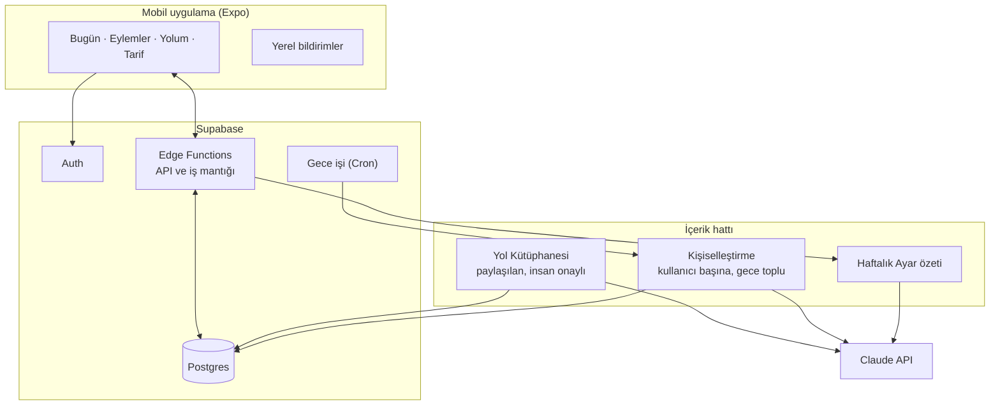

# 4. Teknik Mimari

> Hedef: 1–2 kişilik bir ekibin 6–8 haftada yayına alabileceği, operasyon yükü düşük bir yapı.

## Önerilen stack

| Katman | Seçim | Neden |
|---|---|---|
| Mobil | **React Native + Expo** (TypeScript) | Tek kod tabanıyla iOS ve Android, hızlı iterasyon, uygulama mağazasına girmeden güncelleme (OTA). Scroll yakalama için gereken native kod Expo Modules ile yazılabilir. |
| Backend / veritabanı | **Supabase** (Postgres, Auth, Edge Functions, Cron) | Kullanıcı–sütun–kart–eylem ilişkileri SQL'e çok uygun; satır düzeyinde güvenlik; ayrı sunucu yönetimi gerekmez. |
| İçerik üretimi | **Claude API** (resmi TypeScript SDK, yalnızca sunucu tarafında) | Müfredat ve kart üretimi, kişiselleştirme, haftalık özet. API anahtarı asla uygulamanın içine konmaz. |
| Bildirim | Expo Notifications | Eylem hatırlatmaları için yerel bildirim, doz için push bildirim. |
| Abonelik | RevenueCat | App Store ve Play aboneliklerini tek API ile yönetir. |
| Ürün analitiği | PostHog | Olay takibi, huniler; gizliliğe uygun yapılandırılabilir. |
| Hata takibi | Sentry | Mobil uygulama ve Edge Function hataları. |

Alternatif olarak Flutter + Firebase de aynı işi görür. Asıl belirleyici, ekibin hangisini bildiği.

## Sistem genel görünümü



## İçerik hattı: 3 katman

İçerik kalitesi ve maliyeti bu mimarinin kalbi. Her kullanıcı için her şeyi sıfırdan üretmek hem pahalı hem de kalitesiz olur. Bunun yerine üç katman:

### Katman 1: Yol Kütüphanesi (paylaşılan, insan onaylı)
- Her **kimlik şablonu × seviye** için 28 günlük bir yol, Claude ile **yapılandırılmış JSON** olarak üretilir.
- Yayına girmeden önce bir insan (kurucu ya da alan uzmanı) gözden geçirir: `draft → reviewed → live`.
- Tüm kullanıcılar aynı çekirdek yolu kullanır. Böylece kalite kontrol edilebilir ve en pahalı üretim bir kez yapılır.
- Kaynaklar (kitap, makale, araştırma) yol öğesine bağlı olarak saklanır.

### Katman 2: Kişiselleştirme (kullanıcı başına, her gece)
- Gece işi her kullanıcı için ertesi günün dozunu hazırlar. Girdiler: tarif, kimlik cümlesi, sütun nedenleri, dünkü geri bildirimler, yapılan ve atlanan eylemler, yansıtma cevapları.
- Model, kütüphaneden sıradaki öğeleri seçer ve **uyarlar**: tonu tarife göre ayarlar, eylemi kullanıcının durumuna göre küçültür ya da büyütür, kullanıcının kendi nedenine atıf yapar, "Bunu neden görüyorum?" açıklamasını yazar.
- Doz ertesi gün için hazırlandığından gerçek zamanlı olması gerekmez. **Message Batches API** ile toplu ve yaklaşık %50 daha ucuza çalışır. Doz sabah hazırdır; uygulama anında, çevrimdışıyken bile açılır.
- Çıktı **JSON şemasıyla doğrulanır** (structured outputs). Şemaya uymayan kart yayınlanmaz, onun yerine kütüphanedeki ham öğe gösterilir.

### Katman 3: Dış kaynak küratörlüğü (Faz 2)
- Her sütun için elle seçilmiş bir kaynak listesi (RSS, YouTube kanalları, podcast'ler).
- Model yeni içerikleri tarife göre puanlar; yalnızca en iyisi "Kaynak" kartı olarak önerilir.
- İçerik kopyalanmaz: **link + neden + ne alacaksın + süre.** Telif açısından da doğru olan bu.

### Doğruluk ve güvenlik
- Hareket/sağlık sütununda tıbbi, diyet ve ilaç tavsiyesi yasak; içerik genel hareket alışkanlığıyla sınırlı.
- Finansal yatırım tavsiyesi verilmez.
- Araştırmaya dayanan iddialar kaynağıyla birlikte saklanır; kaynaksız iddia kütüphaneye girmez.
- Her kartta "Bu kart yanlış / uygunsuz" bildirimi var; bildirimler inceleme kuyruğuna düşer.
- Yansıtma cevaplarında kriz sinyali (ör. kendine zarar verme) görülürse otomatik içerik üretimi durur ve kullanıcıya profesyonel destek kaynakları gösterilir.

### Örnek kart şeması

```json
{
  "type": "uygula",
  "pillar_id": "okuma",
  "track_ref": { "track": "okuyan-biri-baslangic", "day": 9 },
  "title": "3 cümle kuralı",
  "body": "Bu akşam okuduğun bölümü bitirince kitabı kapat ve aklında kalanı 3 cümleyle yaz. Tekrar okumak yerine hatırlamaya çalışmak, öğrendiğini daha kalıcı yapar.",
  "duration_min": 3,
  "action": {
    "title": "Okuduğun bölümü 3 cümleyle özetle",
    "suggested_time": "21:30",
    "fallback": "Sadece 1 cümle yaz"
  },
  "why_shown": "Okuma sütunun %60 · Yol: 2. hafta, 9. gün · Dün 'çok kolay' dedin",
  "sources": [
    { "title": "Make It Stick: The Science of Successful Learning (Brown, Roediger, McDaniel, 2014)" }
  ]
}
```

`fallback`: Her eylemin bir "kötü gün versiyonu" vardır. Eylemi atlamak yerine küçültmek, alışkanlığı korur.

## Veri modeli (ilk taslak)

| Tablo | Önemli alanlar |
|---|---|
| `users` | id, timezone, dose_time, daily_budget_min, plan, created_at |
| `identities` | user_id, statement, version |
| `pillars` | id, user_id, template_id, title, why, level, weight, weekly_minutes, active |
| `recipes` | user_id, version, mix (öğren/uygula/ilham/yansıt), depth, tone, formats[], blocked_topics[] |
| `recipe_changes` | user_id, from_version, to_version, diff, proposed_by (`user` \| `ai`), accepted_at |
| `tracks` | id, template_id, level, title, days, status (`draft` \| `reviewed` \| `live`) |
| `track_items` | track_id, day, type, content (JSON), sources |
| `doses` | id, user_id, date, status, opened_at, finished_at |
| `cards` | id, dose_id, type, pillar_id, track_item_id, content (JSON), why_shown, feedback |
| `actions` | id, user_id, card_id, title, scheduled_for, status (`planned` \| `done` \| `partial` \| `skipped` \| `expired`), done_at |
| `shelf_items` | id, user_id, ref, commit_date, expires_at, status |
| `checkins` | user_id, date, answer, mood |
| `weekly_reviews` | user_id, week, summary, suggestions (JSON), decision |

Kural: Raf en fazla 7 aktif öğe tutar (veritabanı kısıtı + uygulama mantığı). Süresi dolan öğe için kullanıcıya sorulur: **Yap / Bırak.**

## Maliyet modeli (LLM)

Kasım 2026 Claude API liste fiyatlarıyla, aktif kullanıcı başına kaba bir tahmin.

Varsayımlar: Günlük kişiselleştirme ~3K giriş + ~2K çıkış token'ı (modelin düşünme token'ları çıkış olarak faturalanır). Haftalık ayar ~8K giriş + ~2K çıkış token'ı.

| İş | Model (giriş / çıkış, 1M token başına) | Kullanıcı başına / ay |
|---|---|---|
| Günlük kişiselleştirme (Batch, %50 indirimli) | Claude Opus 5.5 ($4 / $20) | ~$0,80 |
| Günlük kişiselleştirme (Batch), alternatif | Claude Sonnet 5.5 ($2 / $10) | ~$0,40 |
| Günlük kişiselleştirme (Batch), alternatif | Claude Haiku 5.5 ($0,10 / $0,50) | ~$0,02 |
| Haftalık ayar özeti (gerçek zamanlı) | Claude Opus 5.5 | ~$0,30 |
| Yol kütüphanesi (tek seferlik, paylaşılan) | Claude Opus 5.5 | 15 yol için toplam ~$30–60; kullanıcı başına ≈ 0 |

**Sonuç:** En güçlü modelle bile aktif kullanıcı başına aylık LLM maliyeti ~$1 civarında; abonelik fiyatının küçük bir kısmı. Bu yüzden model seçimi maliyete göre değil kaliteye göre yapılmalı. Faz 0'da aynı kartları farklı modellerle üretip kör test yapmak (kullanıcılar hangisini daha faydalı buluyor?) en sağlıklı yol.

Maliyeti düşüren tasarım kararları:
- Paylaşılan kütüphane (en pahalı üretim bir kez yapılır)
- Gece toplu üretim (Batch API)
- Sabit sistem talimatı ve kütüphane içeriği için prompt caching
- Günlük kişiselleştirmede düşük `effort` ayarı (düşünme token'larını azaltır)

> Fiyatlar değişebilir; güncel değerler için Anthropic'in fiyat sayfasına bak. Token tahminleri Faz 0'da gerçek kullanımla doğrulanmalı.

## Scroll yakalama: teknik yol

Bu bir Faz 2 özelliği. Platform kısıtları ciddi olduğu için ürünün temel değeri buna **bağımlı olmamalı**.

| Platform | Yol | Kısıt |
|---|---|---|
| iOS | Screen Time API (FamilyControls + DeviceActivity + ManagedSettings) ile seçilen uygulamalarda özel "kalkan" ekranı | Apple'dan **Family Controls dağıtım yetkisi (entitlement)** için başvuru ve onay gerekir; onay süresi belirsiz. Kalkan ekranının özelleştirilmesi sınırlı. |
| iOS (yedek) | Kısayollar (Shortcuts) otomasyonu: "Instagram açılınca bizim uygulamayı aç" | Kullanıcının elle kurması gerekir; adım adım kurulum rehberi şart. |
| Android | UsageStatsManager ile ön plandaki uygulamayı algılama + bildirim ya da tam ekran yönlendirme | Erişilebilirlik (Accessibility) servisi kullanımı Google Play politikalarında sıkı denetlenir; mümkünse kaçınılmalı. |

Öneri: Entitlement başvurusunu Faz 1'de yap (bekleme uzun sürebilir). Faz 2'de iOS'ta Screen Time ile başla; onay gelene kadar Kısayollar yedeğini kullan.

## Gizlilik ve güvenlik

Kullanıcı bu uygulamaya hedeflerini, zaaflarını ve ruh halini anlatıyor. Bu veri, sosyal medya verisinden bile daha hassas.

- **KVKK** (Türkiye) ve AB kullanıcıları için **GDPR** uyumu: aydınlatma metni, açık rıza, veri silme ve dışa aktarma.
- **Veri minimizasyonu:** LLM'e isim, e-posta gibi kişiyi doğrudan tanımlayan bilgiler gönderilmez; yalnızca içerik üretimi için gereken bağlam gönderilir.
- Yansıtma cevapları ve check-in'ler için ek şifreleme.
- Reklam SDK'sı yok, veri satışı yok, üçüncü taraf izleme yok.
- LLM sağlayıcısının veri saklama ve model eğitimi koşulları incelenir ve gizlilik politikasında açıkça yazılır.

## Repo yapısı önerisi

```
stopscrolling/
├── apps/
│   └── mobile/            # Expo (React Native) uygulaması
├── supabase/
│   ├── migrations/        # Veritabanı şeması
│   └── functions/         # Edge Functions (API, gece işi, haftalık ayar)
├── content/
│   ├── tracks/            # Yol kütüphanesi (JSON, sürüm kontrollü)
│   ├── prompts/           # Üretim talimatları
│   └── guidelines.md      # Ses ve ton rehberi
├── bot/                   # Faz 0: Telegram concierge botu
└── docs/
```

İçeriği (yollar, talimatlar) git'te sürüm kontrolüyle tutmak, kaliteyi gözden geçirmeyi ve gerektiğinde geri almayı kolaylaştırır.
